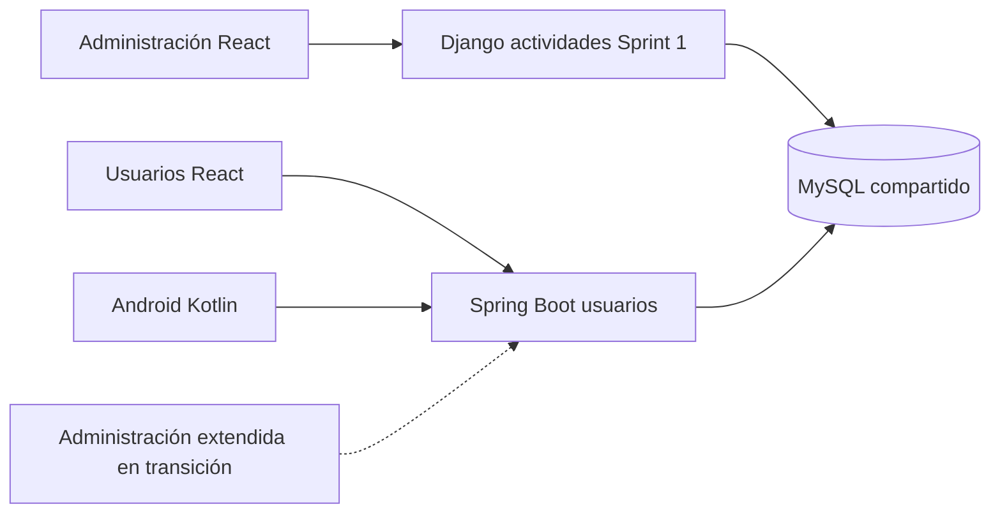
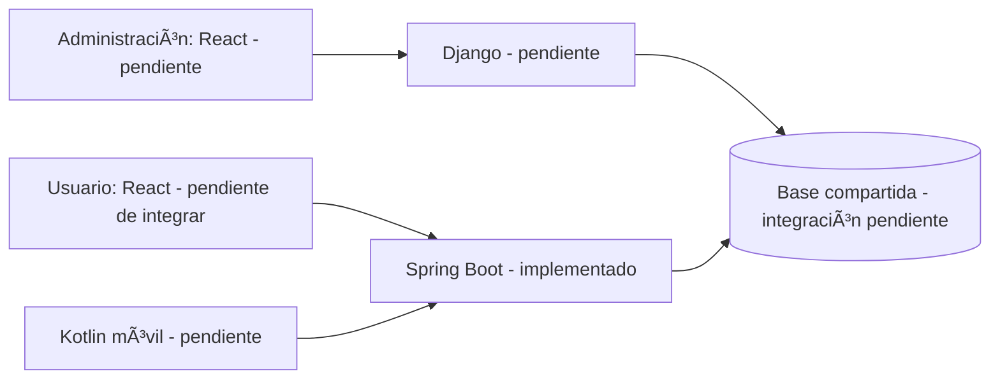
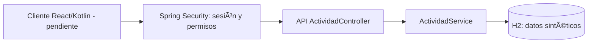
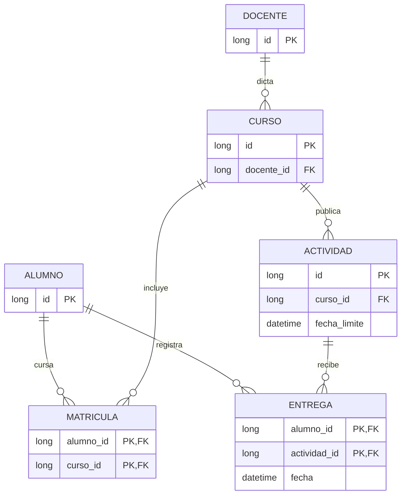

# Arquitectura MAIN

Actualización del 21/10/2026 según el diagrama aportado nuevamente por Jery. Administración React/Django y usuarios React/Kotlin con Spring Boot comparten una base de datos. Se implementó el flujo administrativo de actividades con esta separación; no se declara migrada toda la administración posterior.

## Implementación comprobada el 21 de octubre

- Django sirve el React original y atiende ADMIN, cursos, listado, detalle y creación de actividades. Lee/escribe MySQL directamente; no deriva estas operaciones a Spring.
- Spring sirve la web de usuarios y la API Android. Consulta de actividades limitada a matrícula; entregadas excluidas del listado pendiente. Actividad ajena e inexistente devuelven 404.
- Identidad `main_user` y BCrypt compartidos, sesiones y CSRF independientes. Django revalida rol, activación y versión de contraseña por solicitud.
- Flyway V1–V9 administra negocio. Django usa modelos `managed=False` y solo migra sesiones/registro; no recrea tablas académicas.
- Fechas académicas en hora Lima sin offset, sesión SQL en −05:00. Creación y auditoría Django atómicas.

Entorno local: Spring 8088, Django 8090 y MySQL aislado 3307, loopback. Dato creado por Django leído por Spring y Android con permisos y conservado tras reiniciar MySQL y ambos backends. [Evidencias y límites](REGULARIZACION_SPRINT_12_OCT.md).

La base H2 anterior y su respaldo privado se conservan como ensayos históricos; no se afirma migración de todas sus conversaciones/estados a MySQL.

## Trabajo restante de arquitectura

Los módulos posteriores de cuentas, vínculos, cursos/matrículas y moderación siguen en Spring de compatibilidad. Traslado a Django y paridad completa en M21/M22. Pendientes aceptación del contrato/HU administrativa oficial, HTTPS y dispositivo físico.

[Guía Django](../admin-django/README.md) y [reinicio con configuración privada existente](../scripts/Start-SharedArchitecture.ps1). El iniciador no inicializa ni borra bases y rechaza puertos de otros procesos.

## Antecedente del primer incremento

El contenido siguiente corresponde al estado inicial y conserva sus pendientes históricos; no representa el corte del 21/10 descrito arriba.

## Arquitectura objetivo de las bases 2026-2

La diapositiva 4 presenta: administración con React y Django; usuario con React y Kotlin y backend Spring Boot; ambos backends conectados a una BBDD compartida. Imagen original guardada en evidencia/arquitectura-base-tecsup.png y bases originales en el paquete de fuentes. Esto corrige la lectura textual anterior, que no incluía el contenido de la imagen.

## Componentes implementados en el incremento

## Modelo relacional implementado

Entrega permite saber si una actividad está completada para cada alumno. El listado filtra por matrícula e identidad de la sesión. Consultas parametrizadas con JdbcTemplate; no se concatena texto de búsqueda a SQL.

## Evolución pendiente
Usuarios persistidos; roles docente/apoderado/administración; aplicación móvil nativa; función de IA aprobada; servidor y BD persistente; revisión de arquitectura con los otros cursos.
