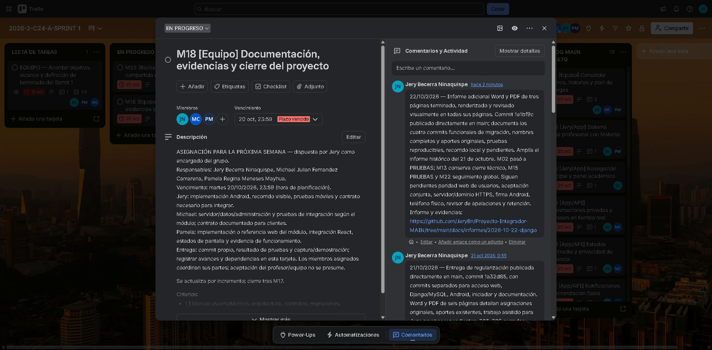

# Trello actualizado el 22 de octubre

Se guardaron y comprobaron comentarios con los commits, pruebas, Word/PDF y límites de la migración. No se modificaron responsables ni se atribuyó aceptación personal a otros integrantes.

| Tarjeta | Estado confirmado | Actualización |
| --- | --- | --- |
| [M02 Arquitectura](https://trello.com/c/RnkwF0eI) | PRUEBAS | Movida desde backlog: migración técnica lista para revisión conjunta; servidor público y acuerdo final pendientes |
| [M13 Administración](https://trello.com/c/OaZqYFzL) | FINALIZADO técnico previo | Comentario ampliado con la migración Django y los cuatro commits funcionales |
| [M15 Pruebas](https://trello.com/c/JjlG2EqD) | PRUEBAS | Resultados 104 Maven, 32 Django, 4 formulario y 3 Android, recorridos HTTP por módulo y límites |
| [M18 Documentación](https://trello.com/c/8EMiZ9A7) | EN PROGRESO | Informe Word/PDF de tres páginas publicado en 1e1bf9c; cierre global condicionado a aceptación/entrega |
| [M22 API compartida](https://trello.com/c/q2Ewnesn) | EN PROGRESO | Migración administrativa completa documentada; seguimiento de contratos y validación global permanece abierto |

Conteo observado después del movimiento: 1 en lista de tareas, 2 en progreso, 10 en pruebas, 0 detenidas, 13 finalizadas y 16 en backlog; 42 tarjetas en total. El conteo no mide porcentaje de esfuerzo.

Las capturas siguientes se obtuvieron después de guardar los comentarios; la falla de captura anterior del recorrido React no afecta estas constancias posteriores de Trello.

