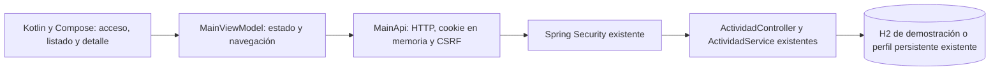

# Arquitectura del cliente Android

La aplicación usa el mismo backend que React. No crea otra base de datos ni guarda actividades de otros usuarios en almacenamiento. La identidad de alumno se resuelve en la sesión del servidor; el cliente no envía alumnoId para obtener permisos.

MainViewModel conserva estado durante recreación de Activity. Búsqueda y filtro pertenecen al listado; abrir/cerrar detalle no los reinicia. Las respuestas de detalle que lleguen después de regresar se descartan mediante un contador de solicitudes. La pérdida de sesión y logout borran perfil, lista, detalle y filtros. Tras terminar el proceso se pide ingresar nuevamente.

La APK debug admite conexión local HTTP mediante adb reverse. La variante release utiliza HTTPS con verificación estándar del sistema. No se incorpora CORS, JWT, certificado inseguro ni autorización simulada para conseguir la integración móvil.

El resultado del estado vencida/completada se toma de la API. Las fechas sin zona del contrato existente se muestran como hora local de Perú, evitando convertirlas según la zona del dispositivo. El contrato compartido se conserva en mobile/README.md; las migraciones y Django continúan en T10 y las tareas de Michael.
